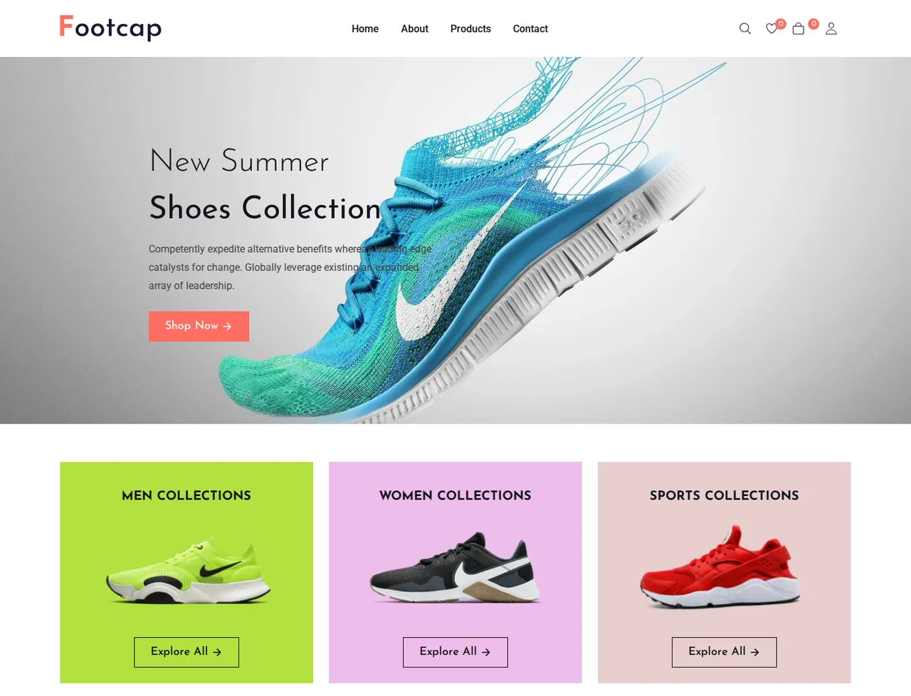
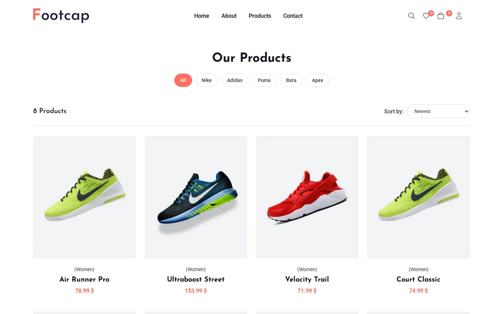
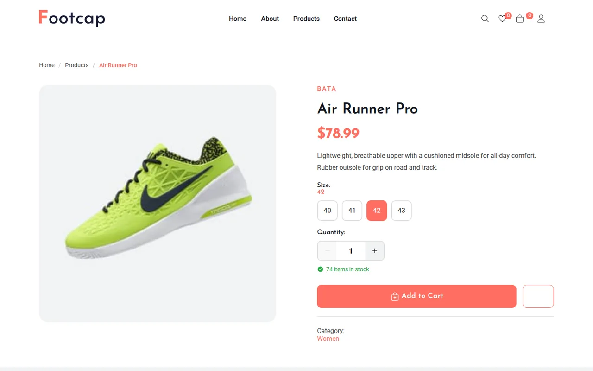
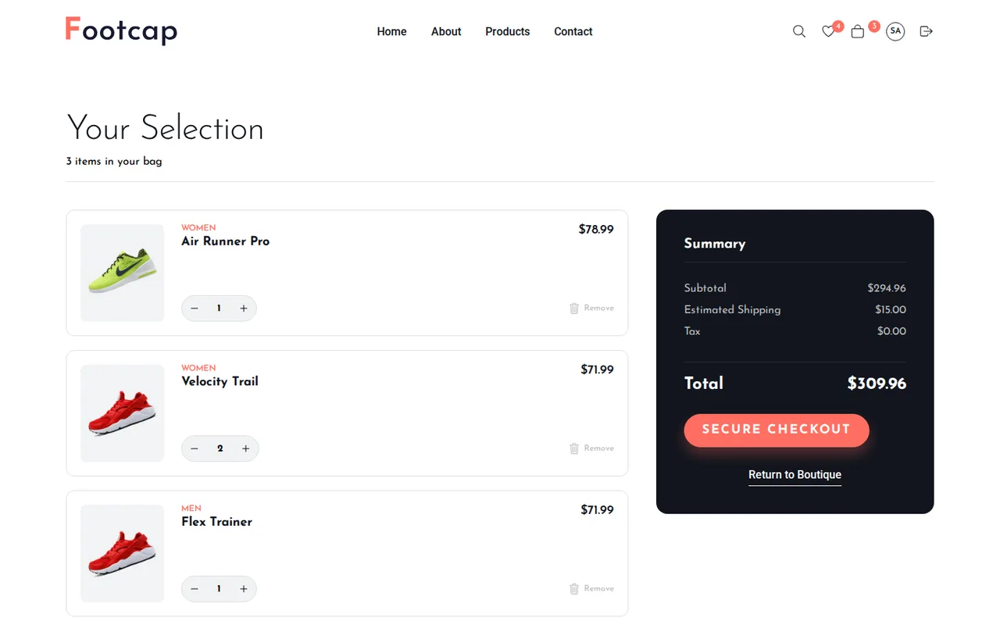
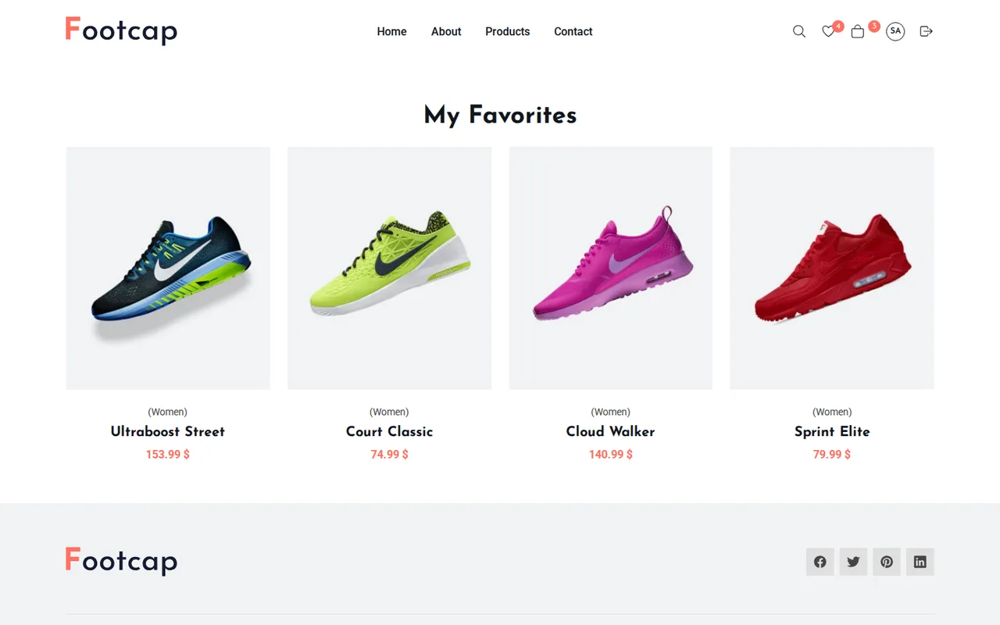
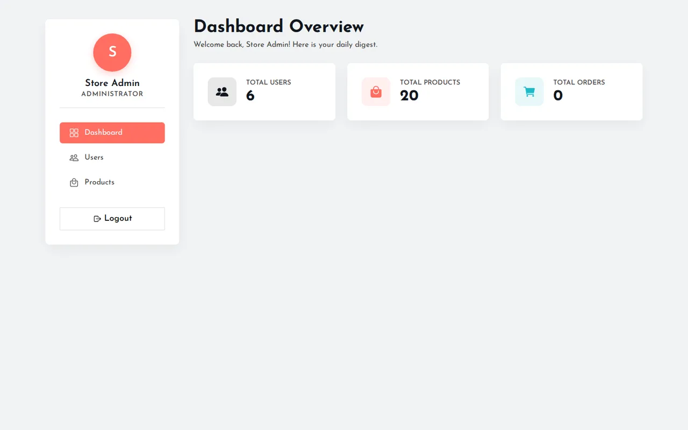
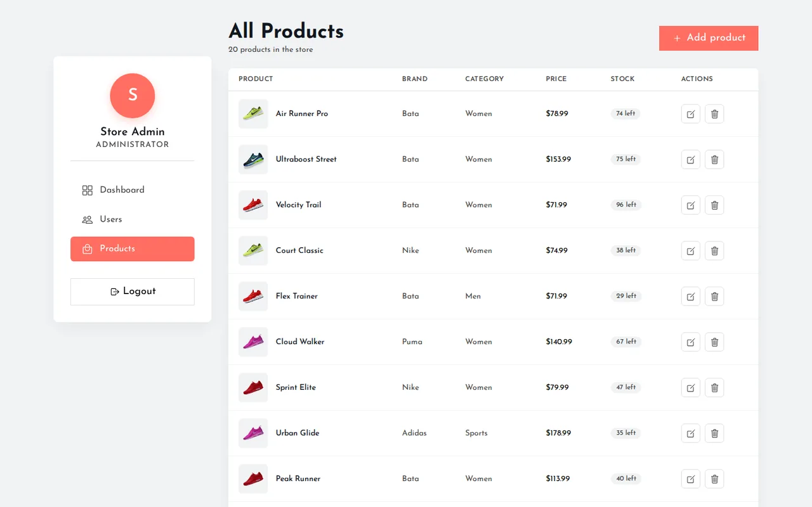
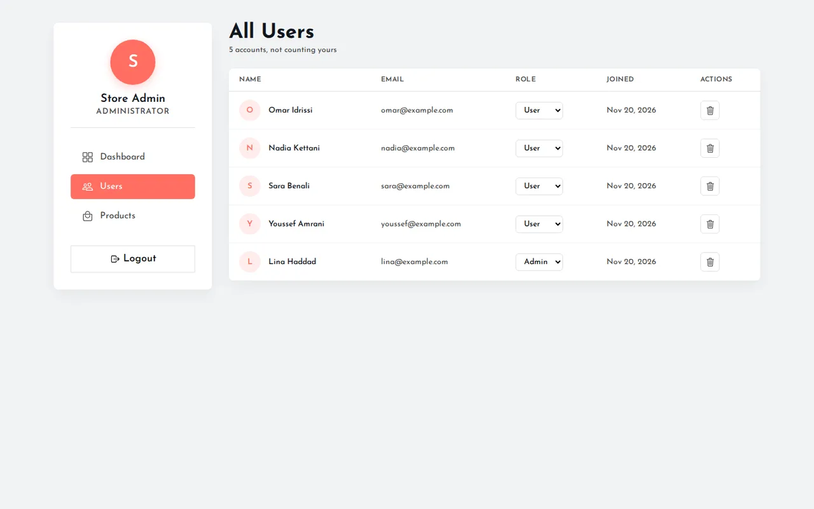
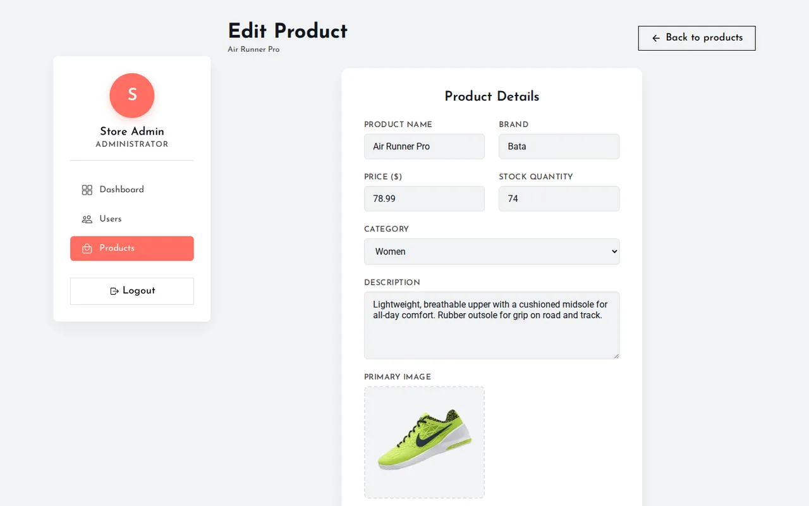
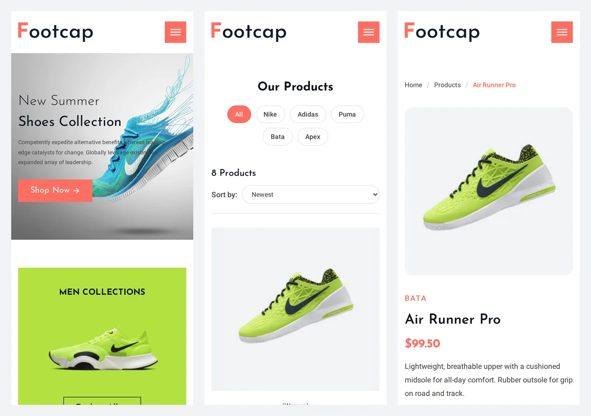

# Footcap: Sports Shoes Store

An online shoe store built with React and Laravel, as a portfolio project. Visitors browse the shoes, filter them by brand and sort them by price or date, and open each shoe's page to pick a size and quantity. Signed-in customers keep a cart and a list of favourites. Admins get a dashboard where they manage products and user accounts.

The React app talks to a Laravel API. Logins use Laravel Sanctum's cookie-based session for single-page apps, so no token is kept in the browser.

**Live demo:** coming soon



> This is a demo store. The products come from the seeder, the prices are invented, and the checkout button does nothing. The page design is based on the free [Footcap template](https://github.com/codewithsadee/footcap) by codewithsadee. The shoe photos belong to their owners.

## Features

**The shop**

- A home page with a hero banner, men's, women's and sports collections, and a photo strip.
- A product grid with brand filters (Nike, Adidas, Puma, Bata, Apex), sorting by date or price, and 8 products per page.
- A page for each product with its brand, price, description, stock, a size picker and a quantity picker.
- About and Contact pages, and a 404 page.
- A layout for phones, with a menu button in the header.

**Customers**

- Registration, login and logout, plus password reset and e-mail verification endpoints on the API.
- A cart saved on the server: add products, change quantities, remove them, and see the subtotal, shipping and total.
- A favourites list, toggled with the heart button on any product card.
- The cart and favourites pages are only open to signed-in users. Counters in the header show how many items each one holds.

**Admins**

- A separate admin area under `/admin`. Admins are sent there when they log in, and other users can't open it.
- A dashboard with the number of users and products.
- A product table with each product's image, brand, category, price and stock. Low stock is highlighted, and each row has edit and delete buttons.
- A form to add or edit a product, with its name, brand, price, stock, category, description and an image upload. When editing, the current image stays unless a new one is picked.
- A user table where admins change a user's role or delete the account. Admins can't delete their own account.

## Screenshots

| Products | One product |
|---|---|
|  |  |
| **Cart** | **Favourites** |
|  |  |
| **Admin dashboard** | **Admin product list** |
|  |  |
| **Admin user list** | **Editing a product** |
|  |  |

On phones:



## Tech stack

| Part | Built with |
|---|---|
| Frontend | React 19, React Router 7, Axios, Vite 7, plain CSS |
| Backend | PHP 8.2+, Laravel 12, Laravel Sanctum 4 (SPA cookie auth), Laravel Breeze (API auth) |
| Database | MySQL |
| Tests and tools | Pest 4, Laravel Pint, ESLint |

## How it's organised

```
backend/                      The Laravel API
  app/Http/Controllers/       Products, cart, favourites, users and the auth controllers
  app/Http/Middleware/        IsAdmin, which guards the admin endpoints
  database/                   Migrations, factories and seeders (20 demo products and an admin)
  routes/api.php              The REST API
  routes/auth.php             Register, login, logout, password reset, e-mail verification
  tests/Feature/              Pest tests for auth, the admin endpoints and the cart
frontend/                     The React app
  src/pages/                  Shop pages, cart, favourites, login, register and the admin pages
  src/components/             Header, footer, product card, product form and others
  src/context/, src/hooks/    Auth, cart and favourites state, and data-fetching hooks
  src/routes/                 Route guards for signed-in users and admins
  public/assets/images/       Product photos, banners and other images
docs/screenshots/             The screenshots in this README
```

## Run it on your computer

You need PHP 8.2 or newer, Composer 2, Node.js 20.19 or newer, and MySQL 8 (or MariaDB).

**1. Set up the backend**

```bash
cd backend
composer install
cp .env.example .env
php artisan key:generate
```

Create an empty MySQL database. Then fill in the database settings in `backend/.env`, and set the address of the React app so the API accepts its requests:

```env
DB_DATABASE=shoes_shop
DB_USERNAME=your_user
DB_PASSWORD=your_password

APP_URL=http://localhost:8000
FRONTEND_URL=http://localhost:5173
```

**2. Create the tables and the demo data**

```bash
php artisan migrate --seed     # 20 demo products and an admin account
php artisan storage:link       # makes uploaded product images reachable
```

The seeder creates an admin account: **test@example.com** / **password**. Register on the site to get a regular customer account.

**3. Start the API**

```bash
php artisan serve              # http://localhost:8000
```

**4. Start the React app** (in a second terminal)

```bash
cd frontend
npm install
npm run dev                    # http://localhost:5173
```

Open **http://localhost:5173**.

The React app expects the API at `http://localhost:8000`. Keep both servers on `localhost`, not `127.0.0.1`, or the browser won't send the login cookie.

**Checks**

```bash
cd backend && php artisan test     # Pest
cd backend && ./vendor/bin/pint    # code style
cd frontend && npm run lint        # ESLint
```

## API

The React app first calls `GET /sanctum/csrf-cookie`, then logs in with `POST /login`. After that the browser sends the session cookie with each request.

**Auth** (no `/api` prefix)

| Method | Endpoint | Who |
|---|---|---|
| POST | `/register`, `/login` | guests |
| POST | `/logout` | signed-in users |
| POST | `/forgot-password`, `/reset-password` | guests |
| GET | `/verify-email/{id}/{hash}` | signed-in users |

**Shop** (under `/api`)

| Method | Endpoint | Who |
|---|---|---|
| GET | `/api/products?brand=&category=&sort=price-asc&inStock=1&page=1` | anyone (8 per page) |
| GET | `/api/products/{id}` | anyone |
| GET | `/api/user` | signed-in users |
| GET / POST | `/api/cart` (`product_id`, `quantity`) | signed-in users |
| DELETE | `/api/cart/{id}` | signed-in users |
| GET / POST | `/api/favorites` (`product_id`) | signed-in users |
| DELETE | `/api/favorites/{productId}` | signed-in users |

**Admin** (under `/api`)

| Method | Endpoint | Who |
|---|---|---|
| POST / PUT / DELETE | `/api/products[/{id}]` | admins (send image uploads as `POST` with `_method=PUT`) |
| GET | `/api/products_statistic`, `/api/users_statistic` | admins |
| GET | `/api/users` | admins |
| PATCH | `/api/users/{id}` (`role`: `user` or `admin`) | admins |
| DELETE | `/api/users/{id}` | admins (not their own account) |

## Still to do

- Checkout and orders
- Search
- Moving the API address into a Vite environment variable
